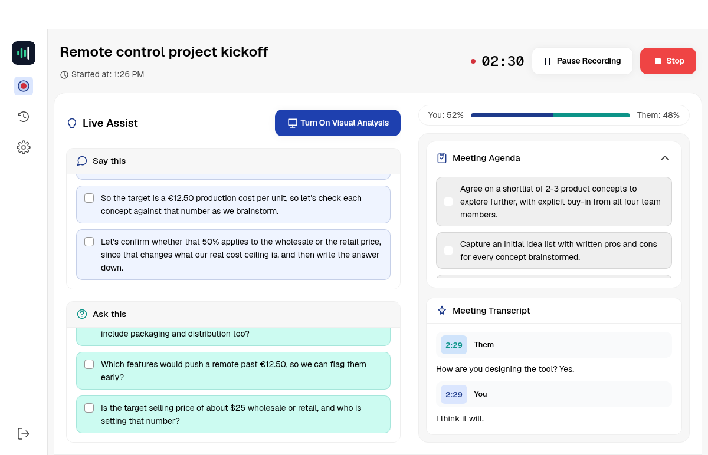
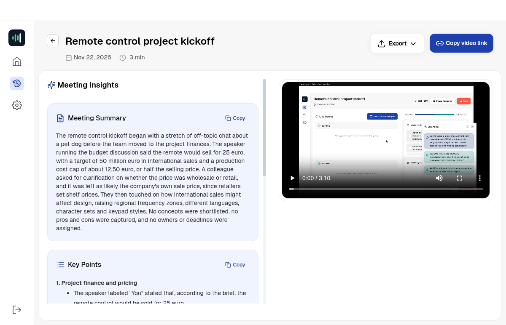
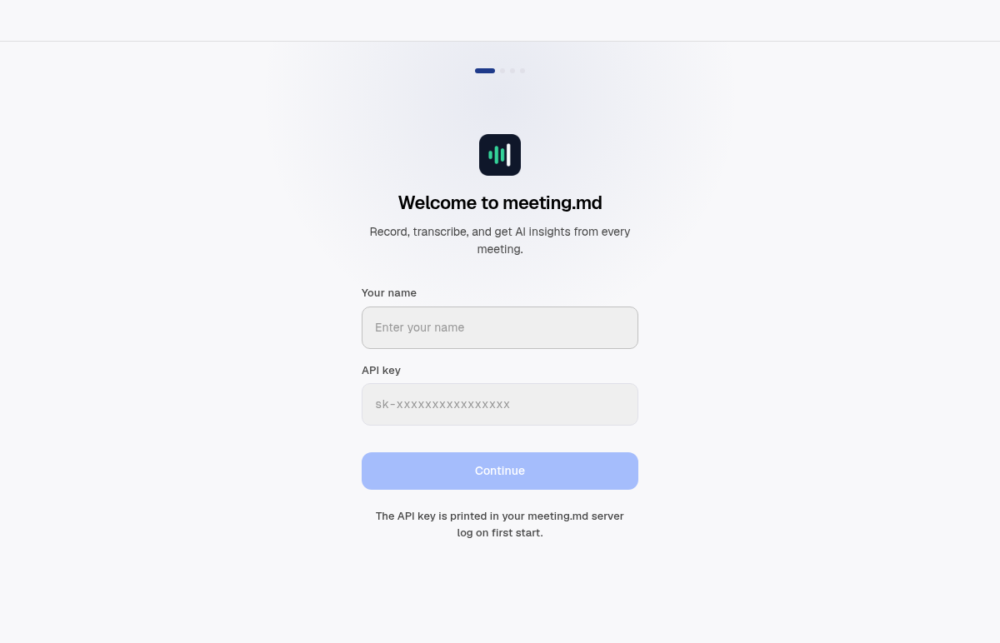
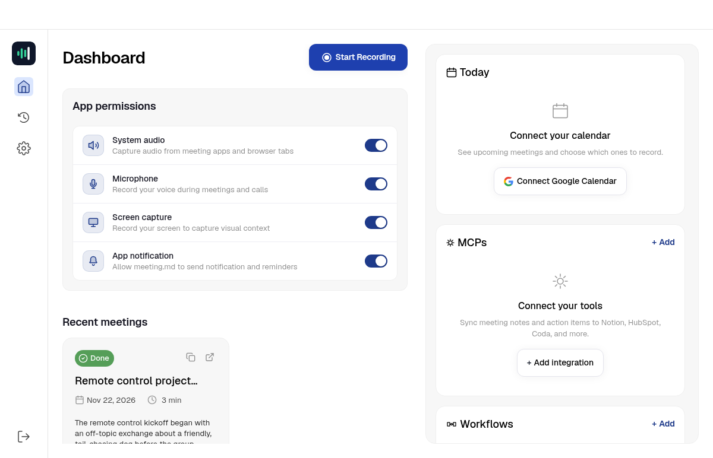
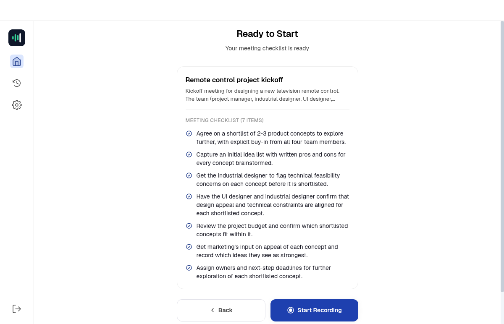

# meeting.md

Self-hosted meeting recording with live transcription, live suggestions and AI
notes. A desktop app records the call; a backend you run does the ingest,
transcription, LLM calls, storage and playback.

The desktop app is a fork of [Call.md](https://github.com/video-db/call.md) by
VideoDB, which sends all of that to VideoDB's cloud. meeting.md is not
affiliated with or endorsed by VideoDB.

| During the meeting | Afterwards |
| --- | --- |
|  |  |

| Sign-in | Dashboard | Meeting prep |
| --- | --- | --- |
|  |  |  |

Screenshots are from a real run using the Claude Code provider. The meeting
shown is ES2002a from the [AMI Meeting Corpus](https://groups.inf.ed.ac.uk/ami/corpus/)
(CC BY 4.0).

```
app/            desktop app (fork of Call.md): backend URL override, Linux recording
capture-linux/  Linux stand-in for VideoDB's closed capture binary
server/         VideoDB-API-compatible backend (Node, no build step)
deploy/         MediaMTX config and RTSPS certificate script
e2e/            End-to-end checks driven by the real `videodb` SDK
upstream/       Reference copies used for the analysis (not needed at runtime)
```

## How it fits together

```
desktop app ──REST + WebSocket──▶ server ──▶ LLM: OpenAI-compatible, OpenRouter, Anthropic, or Claude Code
     │                              │  └────▶ any OpenAI-compatible Whisper
     └─ capture binary ──RTSP(S)──▶ MediaMTX ──▶ server (ffmpeg: record, 16 kHz tap, export)
```

1. The app validates your API key, creates a capture session and opens event sockets.
2. The capture binary calls `POST /capture/session/start` and gets one RTSP URL per
   channel (mic, system audio, screen), then publishes to them.
3. The server pulls each stream back from MediaMTX, writes it to disk, cuts the audio
   into utterances and sends them to Whisper; finals go out on the event socket.
4. On stop the tracks are muxed into one MP4 and the app picks it up as the recording.
5. Summaries, live assist, the MCP agent and visual analysis are plain
   `/chat/completions` calls; the server answers them from whichever LLM
   provider you configured, translating where the provider is not OpenAI-shaped.

## Run the backend

Needs Docker and git. Whisper runs on the CPU by default.

### Quick start: published image

```sh
git clone https://github.com/huh12312/meeting.md && cd meeting.md
deploy/gen-cert.sh                 # self-signed cert for RTSPS, pinned by clients
cp .env.example .env               # then choose an LLM, see "LLM providers"
docker compose up -d
docker compose logs server         # prints the generated API key on first start
```

`docker compose up` pulls the server image
[`masterhuh/meeting.md`](https://hub.docker.com/r/masterhuh/meeting.md) from Docker Hub
(amd64 and arm64), along with MediaMTX and a Whisper server. To pin a version,
set `MEETING_MD_IMAGE=masterhuh/meeting.md:0.1.0` in `.env`.

### Build it yourself

Same steps, but build the server image from this repository before starting:

```sh
docker compose build server        # add --build-arg INSTALL_CLAUDE_CODE=0 for a smaller image without the Claude Code CLI
docker compose up -d
```

A locally built image takes precedence over the published one until you remove
it or run `docker compose pull server`.

### Without Docker

Run MediaMTX with `deploy/mediamtx.yml` and any OpenAI-compatible Whisper
server, then:

```sh
cd server && npm install
LLM_PROVIDER=… STT_BASE_URL=http://localhost:8000/v1 node src/index.js
```

Needs Node 22.13+ and ffmpeg on the PATH.

### Settings

`.env` is commented. The two things you must decide are the LLM provider (next
section) and, if the app runs on another machine, `PUBLIC_URL` /
`RTSP_PUBLISH_URL`. On a CPU, keep Whisper `base` (the default); `small` and
larger need a GPU to keep up with live audio.

## LLM providers

Set `LLM_PROVIDER` in `.env`. The app always asks for a tier (`basic`, `pro`,
`ultra`); `LLM_MODEL` answers all three, `LLM_MODEL_BASIC` / `_PRO` / `_ULTRA`
split them.

| `LLM_PROVIDER` | Needs | Notes |
| --- | --- | --- |
| `openai` (default) | `LLM_BASE_URL`, `LLM_MODEL`, optional `LLM_API_KEY` | Any OpenAI-compatible endpoint: Ollama, vLLM, llama.cpp, OpenAI. Requests pass through untouched. |
| `openrouter` | `LLM_API_KEY`, `LLM_MODEL` | Same pass-through, pointed at `https://openrouter.ai/api/v1`. |
| `anthropic` | `ANTHROPIC_API_KEY` | Official SDK, Messages API. `LLM_MODEL` defaults to `claude-opus-5-5`. |
| `claude-code` | `ANTHROPIC_API_KEY` | Runs the Claude Code CLI (`claude -p`) per request. Bundled in the Docker image. |

**Anthropic.** Requests are translated to the Messages API: tools and tool
results, images, JSON mode, streaming. A few things differ from what the app
sends, on purpose: `temperature` is dropped (current models reject it),
`max_tokens` is raised to at least 16000 because thinking counts against it,
and reasoning effort is set from `LLM_EFFORT` (default `medium`). Opus 5.5 on
every live-assist call is thorough but not cheap or instant; if it feels slow,
try `LLM_EFFORT=low` or point `LLM_MODEL_BASIC` at a smaller model. Refusal
fallbacks are on (the API retries a safety decline on a fallback model, billed
at that model's rate); `LLM_REFUSAL_FALLBACKS=off` disables them.

**Claude Code.** Each request spawns the CLI in bare mode with built-in tools
and MCP servers disabled, a replaced system prompt, no session persistence and
an empty working directory, so it behaves as a plain model rather than an
agent. Tools the app's MCP agent offers are described to the model and returned
as tool calls through a JSON schema; they still run in the app, not in the CLI.
Expect a few seconds per call. `LLM_MODEL` takes CLI aliases (`sonnet`,
`haiku`) or full ids; unset uses the CLI's default. Up to
`CLAUDE_CODE_CONCURRENCY` (2) calls run at once.

Authenticate it with `ANTHROPIC_API_KEY`. Anthropic's terms do not allow an
application to route its requests through a Free, Pro or Max subscription
login, so meeting.md does not support running it that way. With an API key the
`anthropic` provider does the same job with less overhead; `claude-code` is
there for setups that standardise on the CLI.


## Run the app

```sh
cd app
npm install        # on Linux this also installs the capture helper
npm run dev        # or: npm run dist:linux / dist:mac / dist:win
```

Enter any name and the API key from the server log. The backend URL comes from,
in order: `MEETING_MD_API_URL`, `runtime.json` in the app's user-data directory,
then the bundled `runtime.json` (`http://localhost:8080`).

Linux recording needs `ffmpeg` and PipeWire/PulseAudio (`pactl`). Screen capture
uses x11grab on X11; on Wayland it goes through the desktop portal and needs
`python-dbus`, `python-gobject` and the GStreamer PipeWire plugin
(`gst-plugin-pipewire` on Arch). If those are missing the app records audio only.

### macOS and Windows

Upstream's own capture binary works against this backend in principle: it speaks
the same control API and publishes RTSP. It insists on RTSPS with a pinned
key, so set `RTSP_PUBLISH_URL=rtsps://<host>:8322`. **This path is untested** — see
below.

## What was verified, and what was not

Verified on Linux (Arch, Node 26, ffmpeg 9), against the unmodified `videodb`
0.3.0 SDK and the forked app running under Xvfb:

- key validation (good and bad), collections, session tokens, event sockets
- recording mic + system audio + screen through the app's own UI
- live transcripts appearing as You/Them (real Whisper, `faster-whisper-base.en`)
- pause/resume, stop, export to MP4, playback in the app's player pane
- post-call summary via the LLM proxy; visual-analysis events; range requests
- `claude-code` provider, live through the server: plain answers, tool calls and
  the follow-up turn, JSON mode, image input
- a real meeting end to end on `claude-code` (Sonnet): ten minutes of a
  four-person meeting from the AMI corpus through the app, covering the setup
  wizard, live assist, summary, key points and action items
- the published Docker Hub image: pulled, run with building disabled, and put
  through the SDK-driven end-to-end test and a recording from the app
- back-to-back meetings in one app session, each getting its own live-assist
  context
- `anthropic` provider against a mock Messages endpoint through the real SDK:
  request translation, tool round-trips with thinking blocks replayed, images,
  JSON mode, streaming, refusal and error mapping
- both plain RTSP and pinned RTSPS publishing; the Docker Compose stack

Not verified:

- **`anthropic` against the real API** (no key on the test machine), and
  **`openrouter`** (no key; it shares the tested OpenAI pass-through path).
- **`claude-code` with an API key.** The provider was exercised with a local CLI
  login during development; bare mode with `ANTHROPIC_API_KEY`, which is how it
  ships, was only checked as far as the CLI accepting the flags.
- **The release workflow.** It has not run; no tag has been pushed.
- **The stock macOS/Windows capture binary.** Its protocol was read out of the
  binary, not observed. Field names for `/capture/session/start` and its use of
  RTSP ANNOUNCE/RECORD with H.264 + AAC are solid. Two things are inferred:
  the pin is base64 SHA-256 of the certificate's public key (set
  `RTSP_TLS_HASH_FORMAT=hex` if not), and the binary appends a private "sync
  trailer" to AAC frames that ffmpeg may or may not tolerate.
- **Wayland screen capture** (`portal-screencast.py`); the GStreamer PipeWire
  plugin was not installed on the test machine. X11 capture was tested.
- A real microphone and real system audio; tests fed audio files to the helper.

## Differences from the hosted product

- Transcription is utterance-based, not streaming: text arrives once a speaker
  pauses (or after 15 s), with no interim partials. Tunable via `STT_*`.
- Transcript accuracy is bounded by the Whisper model you can run in real time.
  Measured on an 8-core desktop CPU with two live channels: `base.en` stays about
  2 s behind; `small.en` is more accurate but drifts 12-44 s behind and keeps
  slipping. The server logs a warning when a stream falls more than
  `STT_LAG_WARN_SECONDS` (20) behind, and prints mean/max lag when a recording
  stops. `STT_PROMPT` takes names and jargon to bias recognition.
- "Chat with video" and the "get an API key" link still point at VideoDB's
  site; search/indexing endpoints beyond what the app uses are not implemented.
- One API key is one tenant. Media URLs are signed but not expiring.
- Videos are a single MP4 served with range requests, not HLS.

## Tests

```sh
cd server && npm test                       # segmentation, LLM provider translation
cd e2e && npm install --ignore-scripts      # then, with the stack running:
mkdir -p node_modules/videodb/bin && ln -sf "$PWD/../capture-linux/capture" node_modules/videodb/bin/capture
API_KEY=… MEETING_MD_MIC_INPUT="-re -stream_loop -1 -i speech.wav" node run.mjs
```

`e2e/launch-app-headless.sh` plus `e2e/cdp.mjs` drive the real app on a virtual
display (`MIC_FILE` / `SYSTEM_FILE` choose the audio for "You" / "Them").
`e2e/replay-live-assist.ts` replays a recorded meeting's transcript through
Live Assist to see what it would suggest, without re-recording:

```sh
cd app && API_KEY=… npx tsx ../e2e/replay-live-assist.ts <server DATA_DIR> ../e2e/sample/context.json
```

## Releases

Pushing a tag `vX.Y.Z` runs `.github/workflows/release.yml`: it runs the server
tests, builds the server image for amd64 and arm64, and pushes it to Docker Hub
as `<user>/meeting.md` tagged `X.Y.Z`, `X.Y` and `latest`. One-time setup in the
GitHub repository settings:

- variable `DOCKERHUB_USERNAME`: your Docker Hub user or organisation
- secret `DOCKERHUB_TOKEN`: a Docker Hub access token with write access

The image contains the API server, ffmpeg and the Claude Code CLI (about 1 GB;
build with `--build-arg INSTALL_CLAUDE_CODE=0` for a 475 MB image without it). MediaMTX and
the Whisper server are pulled from their own registries by `docker-compose.yml`.

## License

meeting.md's own code (the server, the Linux capture helper, deployment files
and tests) is MIT; see [LICENSE](LICENSE). The desktop app in `app/` is derived
from Call.md, © VideoDB, declared MIT upstream. Third-party components,
including ones that ship in the Docker image under their own terms, are listed
in [NOTICE](NOTICE).
